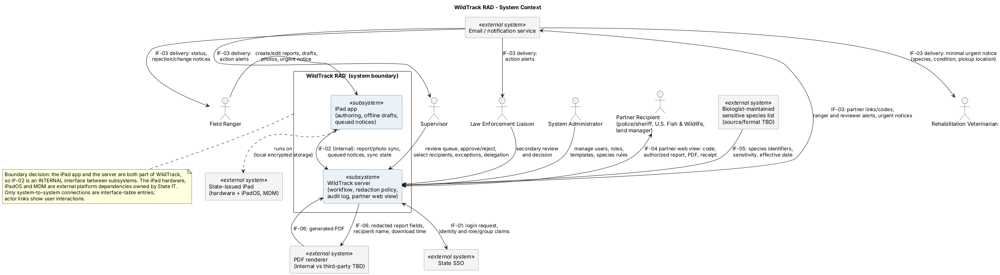

# 2. Requirements Specification: WildTrack RAD

**Version:** 0.1 (draft for customer review, due to Dana Reyes on Nov 12, 2026)
**Scope:** Three-month Northern Region pilot, starting spring 2027
**Sources:** Discovery meeting with Dana Reyes (Customer / Program Manager), kickoff summary email, and Dana's reply

## Conventions

- **Functional requirements (FR)** describe what the system *shall* do from the customer's point of view: one "shall" each, testable, and no design decisions.
- **Technical requirements (TR)** break an FR down into what engineering must build. Each TR traces to exactly one parent FR.
- **Non-functional requirements (NFR)** cover performance, security, availability, accessibility, hosting, and retention.
- **Priority (MoSCoW):** **Must** = required for the spring pilot. **Should** = important, but the pilot can run without it. **Could** = include if time allows. **Won't** = out of scope for the pilot and planned for a later phase.
- **Verification method:** **T** = Test (defined inputs and expected results); **D** = Demonstration (operate and show the capability); **I** = Inspection (review documents, configuration, or code); **A** = Analysis (calculations, models, or operational data).
- FR-01 through FR-05 keep their original IDs because the earliest Jira stories and test cases referenced them. New FRs are numbered from FR-06 and grouped by capability area.

---

## Functional requirements

### 1. Authoring

| ID | Requirement | Priority | Source (persona) | Verification |
|---|---|---|---|---|
| FR-01 | The system shall allow a ranger to create a new incident report from a standard template. | Must | Field Ranger | D |
| FR-06 | The system shall allow a ranger to select more than one incident type for a single report. | Must | Field Ranger | T |
| FR-02 | The system shall allow a ranger to save a partially completed report as a draft. | Must | Field Ranger | T |
| FR-07 | The system shall allow a ranger to create, edit, and save a report without a network connection. | Must | Field Ranger | T |
| FR-08 | The system shall transmit reports submitted while offline once a network connection becomes available. | Must | Field Ranger | T |
| FR-09 | The system shall allow a ranger to attach photos to a report. | Must | Field Ranger, Law Enforcement Liaison | D |
| FR-10 | The system shall assign each report a unique report number. | Must | Supervisor | T |
| FR-03 | The system shall prevent submission of a report until all required fields are complete. | Must | Supervisor | T |
| FR-11 | The system shall require structured evidence details (item collected, collector, date and time, storage location) on any report that includes the poaching incident type. | Must | Law Enforcement Liaison | T |
| FR-12 | The system shall require the authoring ranger to attest to the report's accuracy before submission. | Must | Supervisor, Records Officer | T |

### 2. Review & Approval

| ID | Requirement | Priority | Source (persona) | Verification |
|---|---|---|---|---|
| FR-04 | The system shall allow a supervisor to approve or reject a submitted report, with a required comment on rejection. | Must | Supervisor | T |
| FR-30 | The system shall notify the assigned reviewer when a report is awaiting their action. | Must | Supervisor, Law Enforcement Liaison | T |
| FR-31 | The system shall allow a supervisor to delegate their review authority to a designated backup approver for a defined period. | Must | Supervisor | T |
| FR-13 | The system shall route any supervisor-approved report that includes the poaching incident type to the law enforcement liaison for a second review before dissemination. | Must | Law Enforcement Liaison | T |
| FR-33 | The system shall allow the law enforcement liaison to approve or return a report under secondary review, with a required comment when returning. | Must | Law Enforcement Liaison | T |
| FR-14 | The system shall notify the authoring ranger when their report is rejected, including the rejection comment. | Must | Field Ranger | T |
| FR-15 | The system shall keep a revision history of every submitted report that shows each change, who made it, and when. | Must | Supervisor, Records Officer | T + I |
| FR-16 | The system shall notify the authoring ranger when another user modifies their submitted report. | Should | Field Ranger | T |
| FR-17 | The system shall show each supervisor a list of reports awaiting their action, with overdue reports identified. | Must | Supervisor | D |

### 3. Dissemination

| ID | Requirement | Priority | Source (persona) | Verification |
|---|---|---|---|---|
| FR-29 | The system shall allow a supervisor to select recipients for an approved report and send each recipient their authorized version. | Must | Supervisor | T |
| FR-05 | The system shall withhold or generalize restricted information (e.g., exact GPS coordinates of sensitive species, witness identities) for recipients who are not authorized to see it. | Must | Partner recipients | T + I |
| FR-18 | The system shall allow a ranger to send a minimal urgent notice (species, condition, pickup location) to a rehabilitation veterinarian before the report is approved. | Must | Rehab Veterinarian, Field Ranger | T |
| FR-19 | The system shall give partner recipients access to their version of an approved report without requiring them to create an account or password. | Must | Law Enforcement Agency Recipient | T |
| FR-20 | The system shall allow a supervisor to approve a one-time disclosure exception for a specific recipient, with a required reason. | Must | Supervisor | T + I |
| FR-21 | The system shall allow a designated recipient (U.S. Fish & Wildlife, state police, county sheriff) to acknowledge receipt of a report. | Should | Law Enforcement Agency Recipient | T |
| FR-22 | The system shall allow a partner recipient to download their version of a report as a PDF. | Should | Law Enforcement Agency Recipient | D |
| FR-32 | The system shall mark each downloaded partner PDF with the recipient's name and the download date and time. | Should | Supervisor | T + I |
| FR-23 | The system shall flag reports involving federally protected species with the U.S. Fish & Wildlife notification deadline. | Could *(pending Marcus Webb)* | Records Officer | T + A |
| FR-24 | The system shall allow an administrator to define which recipient categories receive reports for each incident type. | Should | System Administrator | D |

*How FR-29 and FR-24 fit together:* FR-29 is the pilot baseline: after final approval, the supervisor picks the recipients and sends. That's after the liaison's review for poaching reports. FR-24 adds automation on top by pre-filling those recipients from defaults for each incident type, and the supervisor still confirms before anything goes out.

*Why FR-32:* it addresses the eagle-nest leak. A PDF stamped with the recipient's name discourages forwarding, and if a copy does leak, it shows where it came from.

### 4. Administration

| ID | Requirement | Priority | Source (persona) | Verification |
|---|---|---|---|---|
| FR-25 | The system shall allow an administrator to manage user accounts and role assignments. | Must | System Administrator | D |
| FR-26 | The system shall allow an administrator to maintain the sensitive species list. | Must | System Administrator, Lead Biologist | D + I |
| FR-27 | The system shall allow an administrator to add, modify, and mark fields as required in report templates without a software release. | Should | System Administrator | D + T |

### 5. Audit

| ID | Requirement | Priority | Source (persona) | Verification |
|---|---|---|---|---|
| FR-28 | The system shall record who viewed, changed, approved, or sent each report, and when. | Must | Supervisor, Records Officer | T + I |

### Out of scope for the pilot (Won't, this phase)

| Item | Reason |
|---|---|
| Import or search of historical Word reports | Dana confirmed it is not needed for the pilot; leadership may ask for it later. |
| Leadership statistics and charts (monthly counts by type and region) | Dana said a simple pending/overdue list is enough for the pilot. |
| Full chain-of-custody workflow (transfers, sign-offs) | Deferred by Dana; FR-11 structured evidence fields cover the pilot. |
| Public-records and annual-statistics exports | No pilot need; the disclosure rules (county-level location for the public) should be designed so this can be added later. |

---

## Technical requirement decomposition

### FR-02: Save as draft

| ID | Parent | Technical requirement |
|---|---|---|
| TR-02.1 | FR-02 | Each report shall have a `status` attribute with the values `Draft`, `Submitted`, `Returned`, `Pending Liaison Review`, `Approved`, and `Disseminated`; new reports start as `Draft`. |
| TR-02.2 | FR-02 | Drafts shall be stored in encrypted local storage on the device, so saving does not depend on connectivity (see FR-07). |
| TR-02.3 | FR-02 | Saving a draft shall skip required-field validation. |
| TR-02.4 | FR-02 | A draft shall be visible only to its authoring ranger, in a "My Drafts" list. |
| TR-02.5 | FR-02 | Reopening a draft shall restore all field values and attached photos. |
| TR-02.6 | FR-02 | A draft shall not be created until at least one field has a value, so empty drafts don't clutter the list. *(Resolves TC-02; confirm with Dana.)* |

### FR-03: Block submission until required fields are complete

| ID | Parent | Technical requirement |
|---|---|---|
| TR-03.1 | FR-03 | Each template field shall carry a `required` flag defined per incident type. |
| TR-03.2 | FR-03 | The required-field set for a report shall be the agency core fields (author, incident date and time, location, incident type, species, attestation) plus the required fields of **every** selected incident type. |
| TR-03.3 | FR-03 | The client shall disable Submit and list the missing fields until the required set is complete; this check shall work offline. |
| TR-03.4 | FR-03 | `POST /reports/{id}/submit` shall reject an incomplete report with HTTP 422 and a list of the missing fields; the server shall not rely on the client's check. |

*Why TR-03.2 uses a union:* Dana's shot-eagle example. A combined injured-wildlife and poaching report must not let the ranger skip the poaching evidence fields.

### FR-04: Approve or reject with a required comment

| ID | Parent | Technical requirement |
|---|---|---|
| TR-04.1 | FR-04 | `POST /reports/{id}/approve` and `POST /reports/{id}/reject` shall be restricted to the supervisor assigned to the report's region or their active delegate (FR-31). |
| TR-04.2 | FR-04 | Both actions shall be allowed only when the report status is `Submitted`. |
| TR-04.3 | FR-04 | A rejection without a comment shall be refused with HTTP 400. |
| TR-04.4 | FR-04 | A rejection shall include a reason category (e.g., missing information, wrong incident type, incomplete evidence) in addition to the free-text comment. |
| TR-04.5 | FR-04 | A rejection shall set the status to `Returned` and store the comment, reason category, reviewer ID, and timestamp with the report. |

*Why TR-04.4:* Dana can't tell whether repeat mistakes are a training problem or a template problem. Reason categories make the rejections countable, which also supports the "returned for corrections ≤ 10%" metric.

### FR-05: Withhold or generalize restricted information *(revised from an initial three-level model)*

The original three-level model (`public` / `partner` / `restricted`) doesn't fit Dana's rules: what a recipient sees depends on **who** they are, **which** species is involved, and **what kind** of case it is. For example, police see exact coordinates only on poaching cases, and land managers get a location within about a mile.

| ID | Parent | Technical requirement |
|---|---|---|
| TR-05.1 | FR-05 | Each report field shall carry a data class (e.g., `location`, `witness_identity`, `evidence`, `general`). |
| TR-05.2 | FR-05 | A disclosure policy table shall map each combination of recipient category, data class, and report context (sensitive species Y/N, poaching Y/N) to one of three outcomes: `full`, `generalized`, or `withheld`. |
| TR-05.3 | FR-05 | Location generalization shall support these levels: exact, approximate (about 0.25 mile, proposed, for a rehab vet pickup near a nest), about 1 mile (land managers), and county (public). |
| TR-05.4 | FR-05 | The `GET /reports/{id}` endpoint shall return withheld fields as `"[REDACTED]"` and generalized fields at the permitted precision. |
| TR-05.5 | FR-05 | Redaction shall be enforced server-side; the client shall never receive values the recipient is not allowed to see. |
| TR-05.6 | FR-05 | For species not on the sensitive species list, location shall be `full` for every recipient of the report. |
| TR-05.7 | FR-05 | Every disseminated copy shall be logged with the recipient, timestamp, and disclosure outcome applied to each data class. |

*Starting policy, from Dana (to be confirmed with Dr. Priya Anand and Legal Counsel):*

| Recipient | Exact location of a sensitive species | Witness identity |
|---|---|---|
| Authoring ranger, supervisor, law enforcement liaison | Full | Full |
| U.S. Fish & Wildlife | Full | *Open question* |
| State police / county sheriff | Full on poaching cases only | Full on poaching cases |
| Rehab veterinarian | Pickup location; about 0.25 mile (proposed) if found near a nest | Withheld |
| Land managers | About 1 mile | Withheld |
| Public | County | Withheld |

### FR-10: Unique report number

| ID | Parent | Technical requirement |
|---|---|---|
| TR-10.1 | FR-10 | Each report shall get a device-generated UUID when it is created, for use as its internal key (this works offline). |
| TR-10.2 | FR-10 | The server shall assign a human-readable report number in the format `NR-YYYY-NNNNN` (region, year, sequence) when the report first syncs. |
| TR-10.3 | FR-10 | The server shall enforce uniqueness of report numbers with a database constraint. |
| TR-10.4 | FR-10 | Until a report syncs, the app shall display "Number pending." |

*Why this split:* a sequential number can't be guaranteed unique on an offline iPad, but a UUID can. That's the same duplicate-number problem rangers have today. *Open question:* do rangers ever need the official number while they're still in the field?

### FR-18: Urgent notice to a rehab veterinarian

| ID | Parent | Technical requirement |
|---|---|---|
| TR-18.1 | FR-18 | The "Notify rehab vet" action shall be available when the report includes the injured-wildlife incident type, whatever the report's status, including `Draft`. |
| TR-18.2 | FR-18 | The notice shall contain only the species, number of animals, condition, pickup location, and ranger contact information. |
| TR-18.3 | FR-18 | The pickup location shall pass through the FR-05 disclosure policy for the rehab vet recipient category. |
| TR-18.4 | FR-18 | If the device is offline, the notice shall be queued and sent ahead of all other pending syncs, and the ranger shall see that it is queued, not sent. |
| TR-18.5 | FR-18 | Each notice shall be logged with the recipient, content, and timestamp. |

*Why TR-18.4 matters:* if the app shows "sent" when the notice is only queued, a ranger might not call the vet. An unclear status here could delay animal care.

---

## Non-functional requirements

| ID | Category | Requirement | Verification |
|---|---|---|---|
| NFR-01 | Usability | Report drafts shall autosave to the device at least every 30 seconds. | T |
| NFR-02 | Accessibility | The authoring screen shall meet WCAG 2.1 AA. | T + I |
| NFR-03 | Usability / adoption | The median time to complete a standard injured-wildlife report in WildTrack shall be no longer than the Word baseline measured at pilot kickoff. | T |
| NFR-04 | Offline | A ranger shall be able to keep at least 20 drafts, including photos, on the device for at least 7 days without syncing. | T |
| NFR-05 | Performance | Report screens shall load in 2 seconds or less at the 95th percentile, including September-November peak periods. | T |
| NFR-06 | Availability | The server components shall be available 99.5% of the time during pilot business hours, excluding scheduled maintenance announced 48 hours ahead. | A |
| NFR-07 | Platform | The authoring app shall run on the agency's state-issued iPads (supported iPadOS versions to be confirmed with State IT). | T + I |
| NFR-08 | Hosting | The system shall be hosted on the state IT office's approved cloud environment (believed to be AWS; confirm with State IT). | I |
| NFR-09 | Security / authentication | Agency users shall sign in with their existing state accounts through single sign-on; partner recipients shall verify their identity with a one-time code sent to their email. | T + I |
| NFR-10 | Security / data protection | Report data shall be encrypted in transit (TLS 1.2 or higher) and at rest, both on the server and on the iPad. | T + I |
| NFR-11 | Security / partner access | Partner report links shall expire after a configurable period (default 14 days). | T |
| NFR-12 | Audit integrity | Audit log entries shall be append-only; no user role, including administrators, shall be able to edit or delete them. | T + I |
| NFR-13 | Retention | Reports, revision history, and audit logs shall be kept for at least 7 years (confirm with Marcus Webb). | A + I |
| NFR-14 | Attachments | The system shall accept at least 10 photos of up to 15 MB each per report. | T |

*Verification note for NFR-03:* conduct a moderated, timed user test with representative rangers completing the same standard injured-wildlife scenario in Word and WildTrack. Compare the median completion times; this is a user study, not an automated benchmark.

*Sizing note for NFR-05:* the agency files about 2,500 reports a year, and about 40% (roughly 1,000) arrive between September and November, so about 11 a day. That's a small load. Peak season is mainly a reason to avoid outages and training during those months, not a scaling problem.

*Verification note for NFR-06 and NFR-13:* a short test cannot establish availability over months or retention over seven years. Analyze monitoring and retention evidence over the agreed observation period and inspect the approved operational policies/configuration.

---

## System Context

The iPad app and the server are both WildTrack subsystems, so IF-02 is internal; the iPad hardware, iPadOS and MDM are external platform dependencies. See also the [use case diagram](diagrams/use-case-diagram.png).

## External Interfaces

These are logical interfaces for the pilot, not approved implementation choices. Protocols, vendors, formats, and operational owners remain subject to State IT and customer confirmation.

| ID | Interface | Direction | Data exchanged | Protocol / format | Owner | Related reqs | Open issues |
|---|---|---|---|---|---|---|---|
| IF-01 | State single sign-on | WildTrack <-> State SSO | Login request; user identity and role/group claims; authentication result | SAML 2.0 or OIDC over HTTPS (TBD) | State IT | NFR-09, FR-25 | Which protocol is approved? Do state groups map to WildTrack roles, or are roles assigned in WildTrack? How are account disablement and offline reauthentication handled? |
| IF-02 | State-issued iPad app to WildTrack server sync **(internal interface between WildTrack subsystems)** | iPad app <-> WildTrack server | Report fields, UUID and assigned report number, photos, queued urgent notices, revision/sync state, and server responses | HTTPS API with JSON metadata and photo upload format TBD; TLS 1.2+ | State IT / WildTrack application team | FR-07, FR-08, FR-09, FR-10, FR-18, NFR-10 | What sync-conflict rule applies when the same report changes on device and server? How are retries made idempotent? Which iPadOS versions, MDM controls, local encryption, and attachment limits are approved? |
| IF-03 | Email and notification service | WildTrack -> notification service -> recipients | Partner access links and one-time codes; ranger rejection/change alerts; reviewer action alerts; minimal urgent vet notices | Approved provider API over HTTPS and email delivery; payload format and templates TBD | State IT / WildTrack application team | FR-14, FR-18, FR-19, FR-30, NFR-09, NFR-11 | Which email/notification service is approved? May email contain any report data or only a link? What delivery, retry, bounce, and audit evidence is available? |
| IF-04 | Partner recipient web view | Partner recipient <-> WildTrack | One-time-code verification; recipient identity; authorized/redacted report fields; PDF download; receipt acknowledgement | HTTPS browser interface; code delivery uses IF-03; PDF format TBD | WildTrack application team / partner agency contacts | FR-05, FR-19, FR-21, FR-22, FR-29, FR-32, NFR-11 | How is a recipient's email address verified and maintained? What rate limits and code expiry apply? Does a receipt acknowledgement prove that the named person reviewed the report, or only that the link was opened? |
| IF-05 | Sensitive species list source | Biologist-maintained list -> WildTrack (via administrator entry or import) | Species identifier/name, sensitivity status, effective date, and any approved location-sharing rule | Admin UI entry or versioned CSV import (TBD); no external feed is assumed | Dr. Priya Anand (list owner) / System Administrator | FR-05, FR-26 | Is the authoritative source a file, database, or manual list? Who approves updates and how often? How are versions/effective dates tracked, and do changes apply retroactively to already-distributed reports? |
| IF-06 | PDF generation | WildTrack -> PDF renderer; generated PDF returns to WildTrack | Recipient-authorized report fields only, recipient name, download timestamp, and generated PDF | Internal library/service preferred pending decision; if external, approved HTTPS API and PDF format TBD | State IT / Records Officer | FR-05, FR-22, FR-32, NFR-10, NFR-13 | Is rendering internal or third-party? If external, what data leaves the approved boundary, where are temporary files stored, and how are deletion, access logging, and regional hosting controlled? Redaction must happen before any external renderer receives data. |

---

## Assumptions

- The Northern Region pilot users all have state-issued iPads and state accounts.
- Each partner recipient has a reachable email address that the agency maintains.
- Supervisors are assigned by region; the Northern Region has one approving supervisor (Tom Kessler), so a backup approver is needed when he's away (FR-31).
- Rangers keep calling rehab vets by phone in emergencies; FR-18 supplements the call and does not replace it.

## Open questions

| # | Question | Owner | Affects |
|---|---|---|---|
| 1 | When a supervisor edits a submitted report instead of returning it, should the ranger re-attest before it goes out? Dana flagged this as a court risk. | Dana, Marcus Webb | FR-12, FR-15, FR-16 |
| 2 | What is the verified U.S. Fish & Wildlife notification deadline for federally protected species (possibly 48 hours)? | Marcus Webb | FR-23 |
| 3 | What counts as a legally sufficient ranger attestation: a state-account sign-in plus a confirmation, or a formal e-signature? | Marcus Webb, Legal Counsel | FR-12 |
| 4 | If a species is added to the sensitive list mid-season, should restrictions apply to reports already disseminated? | Dr. Priya Anand | FR-05, FR-26 |
| 5 | Should U.S. Fish & Wildlife see witness identities? | Legal Counsel | FR-05 |
| 6 | When does a report become "overdue" for a supervisor, and for the liaison? | Dana | FR-17 |
| 7 | Does "under 1 business day" apply to the median or to every standard report? | Dana | Success metric |
| 8 | Which cloud environment, single sign-on method, and iPad storage controls are approved? | State IT | NFR-07 to NFR-10 |
| 9 | Do rangers need the official report number while still offline? | Dana, Tom Kessler | FR-10 |
| 10 | Who is the Northern Region's backup approver when Tom Kessler is away, and who backs up the law enforcement liaison? | Dana | FR-31 |
| 11 | Can receipt confirmation (FR-21) and PDF download (FR-22) be deferred to Should? Dana described both as partner needs but didn't list them as must-haves. | Dana | FR-21, FR-22 |
| 12 | Free-text fields can leak restricted information: prototype testing showed the narrative (data class `general`) can mention evidence or exact locations that field-level redaction withholds. Should the narrative get its own data class, should there be a separate partner summary field, or should rangers get guidance prompts? | Dana, Legal Counsel | FR-05, TR-05.1 |
| 13 | How precise should the "approximate" pickup location be when an animal is found near a nest? About 0.25 mile is proposed. | Dr. Priya Anand | TR-05.3 |
| 14 | When the liaison returns a poaching report, does it go back to the ranger, or to the supervisor first? The backlog assumes it goes to the ranger. | Dana | FR-33 |

## Resolved since the initial draft

- ~~Assumption: offline drafts are out of scope for v1.~~ **Reversed.** Dana listed offline use as a Must; without it, rangers won't use the system (FR-07, FR-08).
- ~~Does the customer need an approval chain longer than one supervisor?~~ **Yes, for poaching.** Any report that includes poaching goes to the law enforcement liaison after the supervisor (FR-13).
- **Can supervisors override redaction for a specific partner?** Yes, with a recorded reason (FR-20). Dana answered this in her reply.
