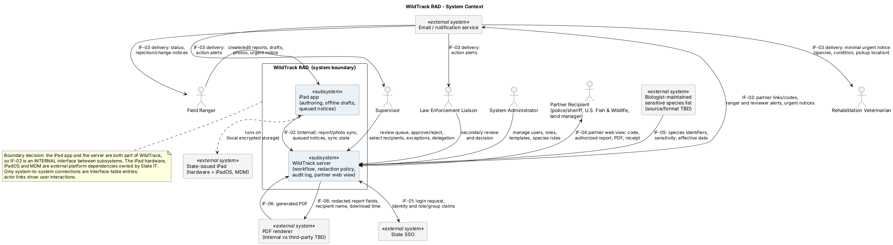
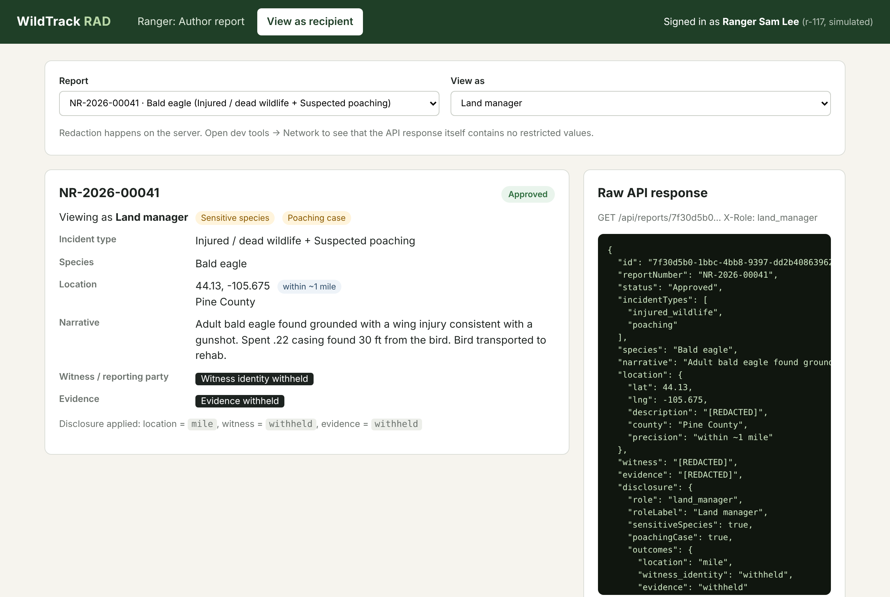
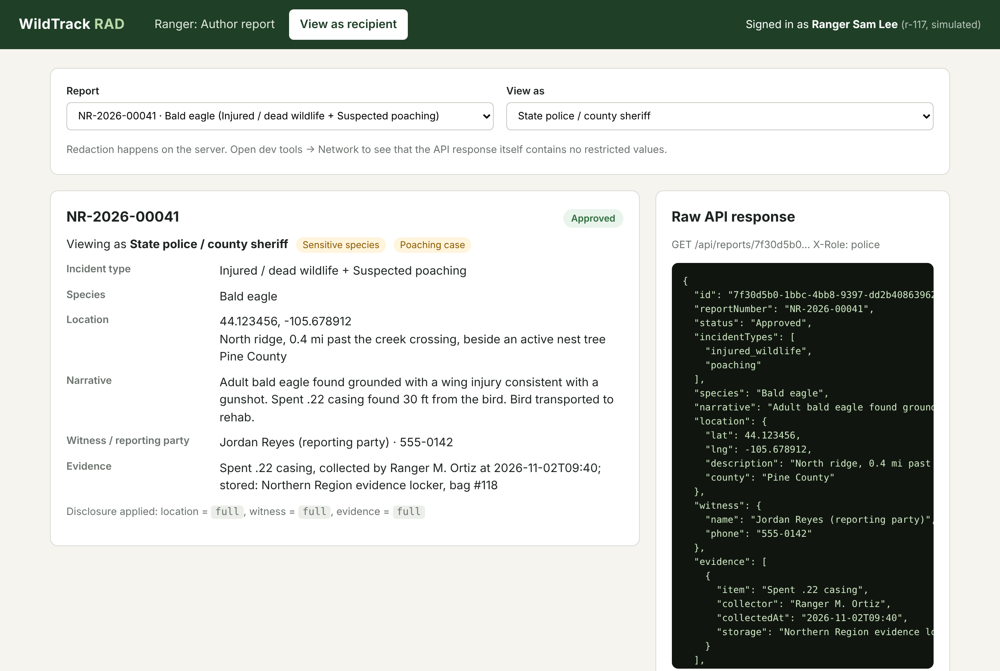
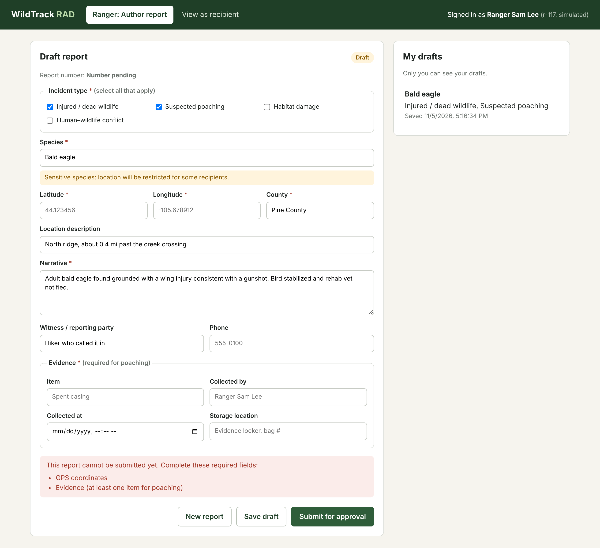

# WildTrack RAD: Report Authoring & Dissemination System

**A requirements-to-delivery systems engineering project:** from a stakeholder interview to a requirements spec, Agile backlog, system models, a working prototype, and traced test results.

📄 **[Requirements spec](02_requirements_spec.md)** · 🧪 **[Prototype](prototype/)**

---

## Summary

A (fictional) state wildlife agency's rangers file incident reports as emailed Word documents. Approvals take about four days, one in five reports is sent back for fixes, and sensitive information, like the location of an active eagle nest, has leaked to people who shouldn't have it.

I gathered requirements in a simulated customer interview, wrote **33 functional and 14 non-functional requirements**, broke the riskiest ones down into **31 technical requirements**, defined **6 external interfaces**, planned **27 user stories (77 points)** in Jira, and built a prototype of the two highest-risk stories, verified by **13 automated tests traced to requirements**. Every functional requirement traces to a Jira story in the [traceability matrix](04_traceability_matrix.csv).

## What this demonstrates

| Skill | Where to see it |
|---|---|
| Stakeholder elicitation and analysis | [Problem statement, personas, stakeholders](01_problem_and_stakeholders.md) |
| Requirements writing and decomposition (FR → TR), MoSCoW prioritization | [Requirements spec](02_requirements_spec.md) |
| Verification planning (Test / Analysis / Inspection / Demonstration) | Verification column in the [spec](02_requirements_spec.md) |
| Interface definition | External Interfaces table (IF-01 to IF-06) in the [spec](02_requirements_spec.md) |
| System modeling | [Context and use case diagrams](diagrams/) |
| Agile backlog: epics, user stories, Given/When/Then acceptance criteria, sprint planning | [Jira backlog](03_jira_backlog.csv) |
| UX collaboration | [Wireframes](wireframes/) |
| Software concepts: REST API, server-side enforcement | [Prototype](prototype/) |
| Functional testing and traceability | [Test cases](04_test_cases.csv), [traceability matrix](04_traceability_matrix.csv), [automated tests](prototype/test/api.test.js) |
| Presenting technical work to non-technical audiences | Plain-language [demo walkthrough](prototype/README.md#demo-walkthrough) |

## Why this scenario

I wanted a project that mirrors the work of a systems engineer on a government reporting system: gathering requirements from a customer, turning them into something a development team can build, and proving it works. Report authoring and dissemination systems are a common type of government software, and they share one hard problem: **the same report has to look different depending on who receives it.**

A wildlife agency makes that problem concrete. A ranger's report about a shot bald eagle might go to the police (who need everything), a wildlife vet (who needs the animal's location right away, but not the witness's name), and a land manager (who only needs the general area). Get it wrong and an endangered species' nest location ends up online, or a witness is put at risk. Add rangers working offline in remote areas, legal record-keeping rules, and staff who will abandon any tool slower than Word, and you get realistic constraints to design around.

It's also personal. As president of ASU's Ocean Conservation Club, I've seen how much conservation work depends on getting the right information to the right people. This let me practice systems engineering on a problem I actually care about.

> **Note:** The agency, people, and data are fictional. The customer interviews were role-played to practice requirements elicitation.

## System context



WildTrack has two subsystems, an offline-capable iPad app and a server, and connects to six external systems: State single sign-on, an email/notification service, the partner web view, the biologists' sensitive species list, and a PDF renderer. The [use case diagram](diagrams/use-case-diagram.png) labels every use case with the requirements it traces to.

## Key design decisions

- **One report, many views.** Redaction is driven by a disclosure policy table: *recipient × type of data × context* (sensitive species? poaching case?) → full, generalized, or withheld. A simpler three-level model didn't fit the customer's rules. For example, police see exact coordinates only on poaching cases. ([TR-05](02_requirements_spec.md))
- **Redaction happens on the server.** Restricted values never reach the browser, so they can't be read in developer tools. The prototype's tests check the raw API response for the real coordinates.
- **Combined incidents use the strictest rules.** A shot eagle is both injured wildlife and poaching, so the report must meet the required fields of every selected type, including poaching evidence. ([TR-03.2](02_requirements_spec.md))
- **Offline-safe report numbers.** A device can't guarantee a unique sequential number without a connection, so each report gets a UUID when it's created, and the server assigns the readable number (`NR-2026-00042`) when it syncs. ([TR-10](02_requirements_spec.md))
- **Urgent animal care isn't held up by approvals.** A minimal notice (species, condition, pickup location) can go to a rehab vet before approval; when offline, it's queued and clearly shown as "queued, not sent." ([TR-18](02_requirements_spec.md))

## Prototype

**One report, different views.** The same approved bald eagle poaching report, as a land manager sees it (left) and as police see it (right). The raw API response on each screen shows that restricted values are never sent to the land manager's browser.

| Land manager: location within ~1 mile, witness and evidence withheld | State police on a poaching case: full details |
|---|---|
|  |  |

**Draft and validation.** A ranger saves a draft, and the server blocks submission until every required field is complete, including poaching evidence on a combined injured-wildlife and poaching report.



## Finding from testing

**Free-text fields can leak restricted information.** In the prototype, a land manager's view correctly withholds the evidence field, but the narrative still mentions "a spent .22 casing." Field-level redaction can't protect details typed into free text. I documented three options for the customer: a separate data class for the narrative, a dedicated partner summary field, or guidance prompts for rangers. See the [prototype README](prototype/README.md).

## How I used AI

I used AI agents (Claude) throughout to streamline the work, the way many engineering teams now do:

- **Elicitation practice:** an AI agent role-played the customer in the stakeholder interview and email exchange.
- **Review:** an AI agent reviewed each draft (stakeholder analysis, requirements, interfaces, diagrams) the way a lead systems engineer would, and I revised based on the feedback.
- **Build:** AI agents generated the prototype code, its automated tests, and the PlantUML diagram sources, and helped draft the wireframes. I reviewed all of it and can walk through every design choice.

The requirements, prioritization, and trade-off decisions are my own, and the agents made me faster at turning them into working, tested artifacts.

## Run the prototype

Requires Node.js 18 or newer. No packages to install.

```bash
cd prototype
node server.js      # then open http://localhost:3000
node --test         # runs the 13 automated tests
```

## Repository layout

```
01_problem_and_stakeholders.md   problem statement, success metrics, personas, stakeholders
02_requirements_spec.md          FRs, TRs, NFRs, interfaces, verification, open questions
03_jira_backlog.csv              epics and user stories with acceptance criteria (Jira import)
04_test_cases.csv                functional test cases
04_traceability_matrix.csv       requirement → story → test
diagrams/                        context and use case diagrams (PlantUML source + PNG)
wireframes/                      ranger form, supervisor queue, partner view
prototype/                       Node.js prototype and automated tests
```

## Status

Version 0.1 of the spec is ready for customer review. Open questions are tracked in the [spec](02_requirements_spec.md), each with an owner (records officer, lead biologist, state IT, legal counsel). Next steps would be customer review of the spec, resolving the narrative-field finding, and a design for offline sync conflicts.
